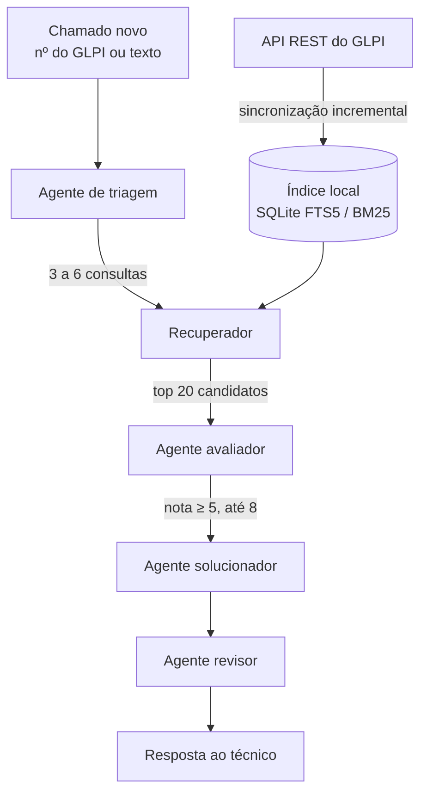

# Assistente de Chamados GLPI

Sistema multiagente com RAG que lê a base de chamados do GLPI e, para cada chamado novo,
devolve ao técnico **as possíveis soluções** e **os chamados antigos que trataram do mesmo
problema**.

## Por que eu fiz isso

Trabalho no service desk e boa parte dos chamados que chegam já foi resolvida antes por
alguém da equipe. O problema é encontrar: a busca do GLPI depende de acertar a palavra
exata, e a resolução quase nunca está no campo "Solução" — ela fica perdida nas respostas
dos técnicos, no meio dos acompanhamentos.

Na nossa base, com mais de 16 mil chamados, só uma fração mínima tinha o campo Solução
preenchido, enquanto os acompanhamentos passavam de 35 mil. Então montei este assistente
para aproveitar esse histórico: ele entende o problema do chamado novo, procura os parecidos
do jeito que um técnico procuraria e resume como cada um foi resolvido.

## Como funciona



### 1. Montagem da base

A sincronização baixa pela API REST do GLPI cada chamado com descrição, acompanhamentos e
tarefas, limpa o HTML e grava num índice local (SQLite com FTS5).

O ponto principal: comparo o autor de cada acompanhamento com a lista de técnicos
(`GLPI_TECNICOS`). Cada resposta é marcada como **[Técnico]** ou **[Solicitante]**, e nos
chamados **Solucionados** ou **Fechados** as últimas respostas dos técnicos viram a
"solução" do chamado. Se o campo Solução do GLPI estiver preenchido, ele tem prioridade.
O nome das pessoas não vai para o texto, só o papel.

Depois da primeira carga, a sincronização traz só o que foi modificado desde a última vez.

### 2. Os agentes

Cada agente é uma chamada ao Gemini com um papel e uma saída estruturada (Pydantic), então o
código sempre recebe campos previsíveis:

| Agente | O que faz |
|---|---|
| **Triagem** | Separa o problema técnico do ruído, extrai sintomas e códigos de erro e escreve de 3 a 6 consultas com sinônimos ("impressora não imprime", "spooler", "fila de impressão"). |
| **Recuperador** | Sem IA. Roda as consultas no índice e funde os rankings com Reciprocal Rank Fusion; chamados resolvidos ganham um bônus. |
| **Avaliador** | Dá nota de 0 a 10 para cada candidato e descarta os falsos parecidos da busca por palavras. |
| **Solucionador** | Propõe até 4 soluções com passos concretos, citando os chamados em que cada uma se baseia. |
| **Revisor** | Confere cada solução contra as fontes, reprova o que não tem base e aponta passos arriscados e quando escalar. |

O técnico recebe um resumo, as soluções com o nível de confiança, alertas, perguntas para o
usuário e os chamados semelhantes com link direto para o GLPI.

### Cuidados

- O texto dos chamados é escrito por usuários, então vai para os agentes como dado (dentro de
  tags) e os prompts mandam ignorar qualquer instrução escrita ali.
- Nenhum agente pode inventar número de chamado; o revisor remove citações que não sustentam
  a solução.
- As chamadas que batem no limite por minuto do Gemini são repetidas automaticamente.

## Estrutura

| Arquivo | Papel |
|---|---|
| `glpi_rag/glpi_client.py` | Cliente da API REST do GLPI e regra de solução pelas respostas dos técnicos |
| `glpi_rag/indice.py` | Índice SQLite FTS5, consultas BM25 e fusão de rankings |
| `glpi_rag/sincronizar.py` | Sincronização completa ou incremental e importação de JSON |
| `glpi_rag/agentes.py` | Os quatro agentes e seus formatos de saída |
| `glpi_rag/orquestrador.py` | Coordena o fluxo e monta a resposta com o rastro de cada etapa |
| `glpi_rag/api.py` e `glpi_rag/static/index.html` | API FastAPI e página do técnico |
| `data/exemplo_chamados.json` | Chamados fictícios para testar sem o GLPI |

## Instalação

Precisa de Python 3.10 ou mais novo.

```powershell
python -m venv .venv
.venv\Scripts\python -m pip install -r requirements.txt
copy .env.example .env
```

Depois preencha o `.env`:

- **Gemini:** a chave sai em <https://aistudio.google.com/apikey>.
- **GLPI:** um administrador habilita a API em *Configurar > Geral > API* e cria um cliente de
  API (App-Token). O token do usuário fica em *Minhas configurações > Chaves de acesso remoto*.
  O ideal é um usuário de serviço só de leitura.
- **GLPI_TECNICOS:** os logins de quem responde os chamados, separados por vírgula.

## Uso

```powershell
.venv\Scripts\python -m glpi_rag sincronizar --completo
.venv\Scripts\python -m glpi_rag servir
```

A página do técnico fica em <http://127.0.0.1:8000>: basta informar o número do chamado ou
descrever o problema. Nas próximas vezes, `sincronizar` sem `--completo` traz só as novidades.

Outros comandos:

```powershell
.venv\Scripts\python -m glpi_rag sugerir --id 1234
.venv\Scripts\python -m glpi_rag buscar "outlook pedindo senha"
.venv\Scripts\python -m glpi_rag importar data/exemplo_chamados.json
.venv\Scripts\python -m pytest -q tests
```

Pela API: `POST /api/sugestoes` com `{"ticket_id": 1234}` ou
`{"titulo": "...", "descricao": "..."}`.

## Privacidade

O índice (`data/chamados.db`) e o `.env` ficam só na máquina e estão no `.gitignore`. A busca
roda localmente; só o chamado analisado e os semelhantes selecionados são enviados ao Gemini.
No nível gratuito do Gemini o Google pode usar esse conteúdo para melhorar os produtos dele,
então para uso com dados reais vale ativar o faturamento no projeto do Google Cloud.

## Próximos passos

- Sincronização automática dentro do servidor, em intervalos configuráveis.
- Busca semântica por embeddings somada ao BM25.
- Publicar a sugestão como acompanhamento privado no próprio chamado.
- Um botão dentro da tela do chamado no GLPI chamando esta API.
